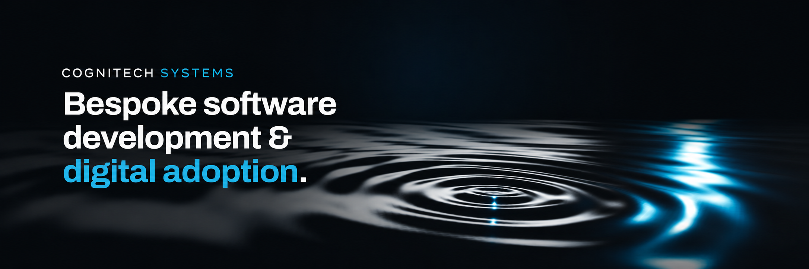
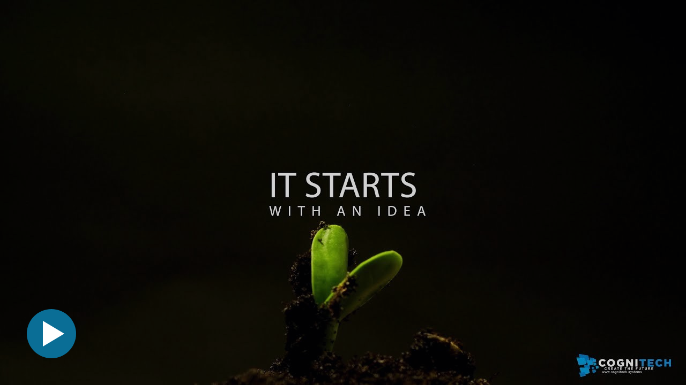

# CogniTech Systems

CogniTech Systems LTD is a software engineering company based in Chester, United Kingdom. We design, build and support software, AI and IoT systems for corporate clients and SMEs, working as a managed delivery team or alongside a client's own engineers.

We also build and operate our own platforms, and publish our research and tooling here as open-source projects.

**[Website](https://www.cognitech.systems)** · **[Services](https://www.cognitech.systems/services/)** · **[Platforms](https://www.cognitech.systems/platforms/)** · **[Open-source](https://www.cognitech.systems/projects/)** · **[Contact](https://www.cognitech.systems/contact)**

## What we do

| AI and machine learning | IoT and edge | Web systems | Infrastructure |
| :--- | :--- | :--- | :--- |
| Machine learning, computer vision, generative AI and local models. | IoT devices, gateways and servers. | ERP, CRM, ecommerce, content management and specialist business systems. | Cloud architecture, DevOps and CI/CD, infrastructure as code, monitoring and security. |

## View Our Video

## Platforms

| Platform | Purpose |
| :--- | :--- |
| [CORE](https://www.cognitech.systems/platforms/core/) | The operational platform for business and enterprise. |
| [IntelliConnect](https://www.cognitech.systems/platforms/intelliconnect/) | Communication infrastructure for IoT devices and AI hardware. |
| [IntelliChain](https://www.cognitech.systems/platforms/intellichain/) | Governance and accountability for digital systems, IoT and AI. |

## Cogy

[Cogy](https://github.com/CogyCode) is our secure, self-hosted software development system for AI agents.

| Repository | Purpose |
| :--- | :--- |
| [Cogy Code](https://github.com/CogyCode/cogy-code) | An AI coding agent and browser IDE that runs on your own hardware. |
| [Cogy Server](https://github.com/CogyCode/cogy-server) | Identity, access control and audit for AI coding agents. |

## Open-source projects

| Project | Focus | Licence |
| :--- | :--- | :--- |
| [Your Voice](https://github.com/CogniTechSystems/your-voice) | Locally hosted language models that write documents in your own voice. | AGPL-3.0 |
| [Bugs Benchmark](https://github.com/CogniTechSystems/bugs-benchmark) | Benchmarks local language models on real debugging tasks, with every fix verified against hidden tests. | AGPL-3.0 |
| [Qwen3.8 Claude Code](https://github.com/CogniTechSystems/qwen3.8-claude-code) | Qwen3.8-27B running locally on Apple Silicon, benchmarked and connected to Claude Code. | Apache-2.0 |
| [Muse-Glimmer-30B Claude Code](https://github.com/CogniTechSystems/muse-glimmer-claude-code) | Meta's Muse-Glimmer-30B running locally on Apple Silicon, benchmarked and connected to Claude Code. | Apache-2.0 |
| [MoE on Arc](https://github.com/CogniTechSystems/moe-on-arc) | Qwen3.6 mixture of experts on Intel integrated graphics, measuring accuracy as well as speed. | Apache-2.0 |

Write-ups, measured results and screenshots for each project are on our [open-source pages](https://www.cognitech.systems/projects/).

## Programmes

CogniTech Systems is part of [AWS Activate](https://www.cognitech.systems/blog/company-news/entry/aws-activate-portfolio), [Google Cloud for Startups](https://www.cognitech.systems/blog/company-news/entry/google-for-startups-cloud-program), [Microsoft for Startups](https://www.cognitech.systems/blog/company-news/entry/microsoft-for-startup-founders-level-4), [IBM Partner Plus](https://www.cognitech.systems/blog/company-news/entry/ibm-partner-plus), Intel Software Innovators and Claude for Startups.

## Work with us

To discuss a project, arrange a discovery meeting through our [contact page](https://www.cognitech.systems/contact). Open positions are listed on our [careers page](https://www.cognitech.systems/jobs/).

**[Website](https://www.cognitech.systems)** · **[LinkedIn](https://www.linkedin.com/company/cognitechsystems)** · **[YouTube](https://www.youtube.com/@CogniTechSystems)** · **[X](https://twitter.com/CogniTechSys)**

CogniTech Systems LTD · Registered in England and Wales, company number 13953837 · 95 Tarvin Road, Chester, CH3 5EF
